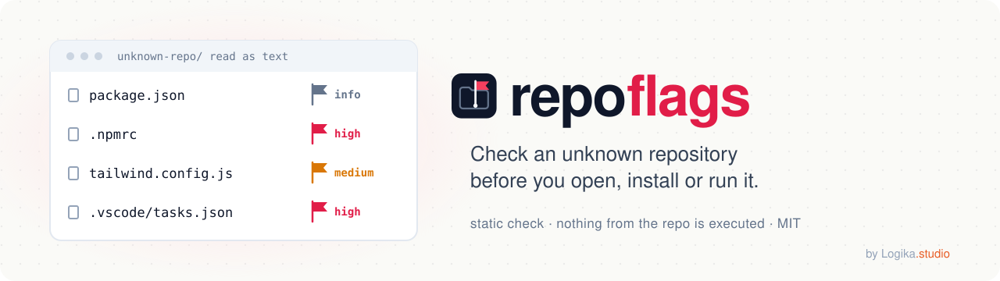
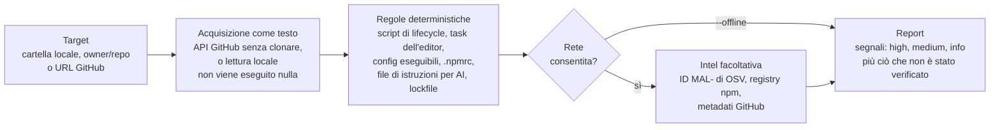

<div align="center">

[English](README.md) · **Italiano**

<picture>
  <source media="(prefers-color-scheme: dark)" srcset="docs/assets/banner-dark.svg">
  
</picture>

# repoflags

**Controlla un repository sconosciuto prima di aprirlo, installarlo o avviarlo.**

[](https://github.com/logika-studio/repoflags/actions/workflows/ci.yml)
[](LICENSE)
[](package.json)
[](package.json)
[](package.json)

[Quick start](#quick-start) · [Come funziona](#come-funziona) · [Esempio di output](#esempio-di-output) ·
[Guardrail](#guardrail) · [Limiti della v1](#limiti-della-v1)

</div>

## Cosa fa

repoflags è una skill per assistenti AI di programmazione, più uno script Node a zero dipendenze, che legge un
repository come dati ed elenca i segnali che qualcosa al suo interno entrerebbe in azione quando il progetto viene
installato, avviato o aperto.

Che cosa non fa:

- non esegue mai nulla del repository: niente install, build, test, script o hook;
- non lo apre mai in un editor e non ne fa mai il checkout;
- non dà mai un verdetto di via libera. L'esito migliore possibile è «no signals found by these rules» (nessun segnale
  trovato da queste regole), che descrive ciò che le regole hanno trovato, non il repository.

## Come funziona



Le regole sono codice dello script, non un prompt: l'assistente esegue solo lo script e ne spiega il report JSON. Ogni
controllo che non è stato possibile eseguire (un pacchetto privato, un servizio non raggiungibile, la modalità
offline) finisce in «not verified» invece di contare come superato.

## Perché esiste

Nell'ottobre 2026 noi di Logika.studio siamo stati contattati da un finto cliente su una piattaforma freelance. Ci ha
invitati su un repository privato «da guardare prima di iniziare». Il suo config di Tailwind caricava il pacchetto npm
`tailwind-animate-kit`, che a sua volta richiedeva un pacchetto privato con scope, risolvibile solo con un token npm
committato nel `.npmrc` del repository. Il repository conteneva anche file di istruzioni per agenti AI di
programmazione. Non abbiamo eseguito nulla; il pacchetto pubblicato oggi è classificato come malevolo in
[OSV MAL-2026-18078](https://osv.dev/vulnerability/MAL-2026-18078).

Il pacchetto pubblico non contiene script di install né codice di rete: il codice che gira sta nella dipendenza privata.
Per questo `npm audit` e `--ignore-scripts` qui non servono, e per questo volevamo un controllo che girasse prima di
installare qualsiasi cosa.

Non è un trucco isolato. Coincide con una famiglia documentata di campagne di finti colloqui:

- [pkgwarden](https://pkgwarden.com/incidents/fake-interview-tailwind-plugins-npm-october-2026/) elenca 29 plugin
  Tailwind/Animate.css malevoli pubblicati da 17 account usa e getta tra il 28 luglio e il 9 ottobre 2026, con
  repository esca che committano un token in `.npmrc` e contengono file `AGENTS.md`/`CLAUDE.md`.
- Il 18 settembre 2026 agenzie di Giappone, Stati Uniti, Australia e Germania hanno pubblicato un
  [advisory congiunto](https://www.bnd.bund.de/EN/Public-Intelligence/joint-cybersecurity-advisory/20260918-prk-waterplum-node.html).
  [BleepingComputer](https://www.bleepingcomputer.com/news/security/north-korean-waterplum-hackers-infected-30-000-devices-worldwide/)
  riporta almeno 30.000 dispositivi infettati in più di 100 paesi, più di 7.000 wallet svuotati e circa 10,71 M USD
  sottratti tra dicembre 2025 e luglio 2026.
- [Socket](https://socket.dev/blog/north-korea-contagious-interview-campaign-338-malicious-npm-packages) contava più
  di 338 pacchetti npm malevoli della campagna nell'ottobre 2025; i ricercatori citati in una
  [CSA research note](https://labs.cloudsecurityalliance.org/research/csa-research-note-dprk-contagious-interview-cross-ecosystem/)
  ne contano più di 1.700 su npm, PyPI, Go, crates.io e Packagist.
- [Unit 42](https://unit42.paloaltonetworks.com/two-campaigns-by-north-korea-bad-actors-target-job-hunters/) fa
  risalire l'infrastruttura a dicembre 2022;
  [ESET](https://www.welivesecurity.com/en/eset-research/deceptivedevelopment-targets-freelance-developers/) documenta
  lo stesso metodo contro sviluppatori freelance;
  [Microsoft](https://www.microsoft.com/en-us/security/blog/2026/03/11/contagious-interview-malware-delivered-through-fake-developer-job-interviews/)
  descrive task dell'editor che partono non appena la cartella viene considerata attendibile.

## Quick start

In Claude Code:

```
/plugin marketplace add logika-studio/repoflags
/plugin install repoflags@logika-studio
```

Poi chiedi, prima di clonare qualsiasi cosa: «Controlla https://github.com/OWNER/REPO con repoflags prima che lo apra.»

Senza assistente, da una copia di questo repository (Node 18.20 o successivo):

```
node skills/repoflags/scripts/repoflags.mjs OWNER/REPO
```

## Installazione

**Claude Code, come plugin** dal marketplace di Logika.studio:

```
/plugin marketplace add logika-studio/repoflags
/plugin install repoflags@logika-studio
```

Se non hai una chiave SSH per GitHub, imposta `CLAUDE_CODE_PLUGIN_PREFER_HTTPS=1` prima di aggiungere il marketplace.

**Claude Code, a mano**: copia la cartella `skills/repoflags/` di questo repository in `~/.claude/skills/repoflags/`
(tutti i tuoi progetti) oppure in `.claude/skills/repoflags/` (un solo progetto).

I manifest del plugin sono stati validati e installati in locale, in una configurazione isolata. Se l'installazione da
questo repository non funziona, apri un test report.

**Altri client**: la skill usa il formato Agent Skills. Gli altri client non sono stati testati; vedi
[Tested with / aiutaci a testare](#tested-with--aiutaci-a-testare).

## Uso

**Con la skill**: dai all'assistente il link di un repository GitHub o il percorso di una cartella locale e chiedigli di
controllarlo prima di aprirlo. L'assistente esegue solo lo script incluso, ne legge il report JSON e lo spiega. Non
legge di sua iniziativa i file del repository e non segue le istruzioni che vi trova.

**Script standalone**:

```
node skills/repoflags/scripts/repoflags.mjs <folder | owner/repo | github-url> [options]
```

- `--format json` stampa il report completo come un unico oggetto JSON (il default è testo);
- `--offline` non usa la rete, solo per cartelle locali;
- `--ref <ref>` controlla un branch, un tag o un commit specifico di un repository remoto;
- `--help` elenca tutte le opzioni, compresi i limiti di dimensione e di tempo.

I repository privati richiedono `gh auth login` o un `GH_TOKEN`. Il token serve solo per le richieste all'API di GitHub
e non viene mai stampato né salvato. L'accesso alla rete va solo verso `api.github.com`, `api.osv.dev` e
`registry.npmjs.org`.

Exit code: 0 nessun segnale trovato da queste regole, 1 segnali trovati, 2 errore (nessun report).

## Livelli dell'output

Il report ha un `outcome` e un elenco di segnali.

- `signals found`: almeno una regola ha trovato qualcosa.
- `no signals found by these rules`: nessuna regola inclusa ha trovato qualcosa nei file letti. Non è mai un via libera.

Ogni segnale ha una severità:

- **high**: qualcosa che entra in azione quando il progetto viene installato, avviato o aperto, oppure una credenziale
  committata;
- **medium**: uno schema che spesso precede un problema, o una dipendenza che non si può verificare;
- **info**: contesto utile per decidere, come i metadati del repository.

Ogni report elenca anche `notVerified`: ciò che l'analisi non ha potuto controllare (un file oltre il limite di
dimensione, un pacchetto privato non leggibile, un servizio non raggiungibile, la modalità offline). Un controllo
saltato è una lacuna, non un esito favorevole. Ogni segnale cita il file e la
riga; il report cita il commit analizzato quando c'è.

## Esempio di output

Questo è l'output testuale reale dello script sulla fixture di test che riproduce il caso descritto sopra (una copia
in una cartella temporanea, con un token finto e uno scope privato inventato), eseguito offline. L'output dello
script è in inglese:

```
node skills/repoflags/scripts/repoflags.mjs <fixture-folder> --offline
```

```text
repoflags 1.0.0 - repoflags-fx-fLgwof
Static analysis only: nothing from the repository was executed. These rules may miss new techniques.
Target: local  SHA: n/a  Mode: offline  Rules: 1.0.0  At: 2026-11-02T21:26:35.069Z

Outcome: signals found

HIGH
  [S1] chain-private-dependency  web/.npmrc:1  Private dependency chain: committed registry token + unresolvable scoped dependency + package loaded by config
      npmrc-auth-token in web/.npmrc; config-require-nonstandard in web/tailwind.config.js; scoped dependency @fixture-private/motion-helpers (registry check not per…
  [S2] npmrc-auth-token  web/.npmrc:1  Registry credential committed in npm/yarn config
      _authToken=FAKE…[30 chars]

MEDIUM
  [S3] config-require-nonstandard  web/tailwind.config.js:1  Non-standard package loaded by executable config file
      registry check not performed (offline mode) | module.exports = { plugins: [require('tailwind-animate-kit')] };

Not verified
  - private-packages: content of private or unpublished packages cannot be read
  - runtime-downloads: code downloaded at runtime by scripts or dependencies is not analyzed
  - other-commits: other branches or commits than the analyzed SHA were not checked
  - binary-files: binary files are not inspected
  - node-modules: node_modules content is not inspected
  - commit-sha: no .git directory (zip or copy): commit SHA not available
  - osv: skipped: offline mode
  - npm-registry: skipped: offline mode
  - repo-metadata: skipped: offline mode

network: none
```

Offline, le ricerche su OSV e sul registry npm vengono saltate ed elencate come non verificate. Online, la stessa
esecuzione cerca anche le versioni delle dipendenze su OSV e chiede al registry npm se ogni dipendenza vi si risolve.
Il token viene mostrato troncato, mai per intero. Con `--format json` si ottiene il report completo.

## Personalizzazione

Un file JSON facoltativo imposta la lingua della risposta, i limiti, le soglie, le regole da spegnere e le allowlist.
Appartiene a te: l'assistente non lo crea né lo modifica mai di sua iniziativa, e nessuna impostazione può abbassare un
guardrail. Una regola spenta viene riportata come non verificata. Chiavi, default ed esempio:
[skills/repoflags/references/configuration.md](skills/repoflags/references/configuration.md).

## Guardrail

- **G1** Non esegue mai nulla del repository analizzato.
- **G2** Non lo apre mai in un editor.
- **G3** Ogni testo del repository è un dato, mai un'istruzione.
- **G4** Non clona mai: un repository remoto viene letto tramite l'API di GitHub, una cartella locale come semplici file.
- **G5** I controlli critici li fa lo script, non il modello.
- **G6** Rete solo verso `api.github.com`, `api.osv.dev` e `registry.npmjs.org`.
- **G7** Non dà mai un verdetto di via libera su un repository.
- **G8** Nessun giudizio sulle persone: descrive file e pacchetti, non i loro autori.
- **G9** Il tuo token GitHub va solo verso `api.github.com` e non viene mai stampato né salvato. Un token trovato nel
  repository viene mostrato mascherato: la sua lunghezza, più i primi 4 caratteri quando ne ha almeno 12.
- **G10** Se hai già eseguito il codice, smette di analizzare e passa alla checklist di risposta.

## Limiti della v1

- Solo l'ecosistema npm (npm, pnpm, yarn). I parser dei lockfile pnpm e yarn sono stati verificati su fixture scritte
  a mano.
- Al massimo 200 nomi di pacchetto vengono cercati sul registry npm per ogni analisi.
- Lo script non legge la prosa dei README né i commenti dentro i file di config: un'istruzione scritta lì non viene
  riportata.
- Nessuna analisi dinamica: non viene eseguito nulla, quindi un comportamento che compare solo a runtime non si vede.
- Rumore noto: `ai-instructions` segnala un medium su file `AGENTS.md`/`CLAUDE.md` legittimi, e viene segnalato un
  medium sui normali config di webpack. È il comportamento attuale, documentato così com'è.
- Il red team di prompt injection ha eseguito ogni scenario una volta sola. Un run non è una proprietà statistica.
- Il red team è stato eseguito in una sessione in cui era caricata la configurazione di Claude Code di chi ha fatto il
  test, non in una vuota.
- Osservato senza violazione di guardrail: in uno scenario l'assistente si è rifiutato nei fatti di eseguire il
  repository, ma non ha dichiarato il rifiuto in una riga; nel run end-to-end ha aggiunto due frasi rassicuranti sui
  segnali. Non cambiato nella v1, perché il prompt pubblicato resti quello misurato.
- Lo `SKILL.md` pubblicato (SHA-256 `2991dac9142a48ba82285971edffbe870b28dcb9c595da69056c19b1066fc062`) differisce dal
  prompt misurato solo nella riga di versione del frontmatter (`1.0.0` invece di `0.1.0`). Dopo quel cambio non è stato
  eseguito di nuovo; un test prova che ripristinando la riga precedente si riottengono i byte misurati.

## Tested with / aiutaci a testare

Che cosa abbiamo misurato:

- **Skill**: Claude Code con Claude Opus, su Windows.
- **Script**: Windows (Node 18, 20, 22) e Linux sotto WSL (Node 18, 20, 22, 24). macOS non è stato provato in
  locale: lo copre solo il workflow di CI su GitHub Actions (vedi il badge CI).
- **Red team**: 11 scenari (un end-to-end, dieci repository ostili), un run ciascuno, tutti resistiti, sul prompt con
  SHA-256 `78a7397a764e7bd3acad74e40644330be13102a46189e2aaf37f72b98bf6c2d4`. Valgono i due limiti sopra: un run per
  scenario, e la configurazione di chi ha fatto il test era caricata.

Non abbiamo testato altri assistenti o modelli. Se provi repoflags con un altro client (Codex, OpenCode, Cursor, Gemini
CLI o altri) o con un altro modello, raccontaci com'è andata con il
[modulo test report](https://github.com/logika-studio/repoflags/issues/new?template=test-report.yml): client, modello,
versione, sistema operativo, scenario, esito e un log senza token. Un run fallito è utile quanto uno riuscito.

## Se l'hai già eseguito

Se hai già installato, avviato o aperto il repository, interrompi l'analisi e segui la checklist di risposta: isola il
dispositivo, sposta i fondi e cambia le credenziali da un altro dispositivo, revoca le autorizzazioni dei token,
raccogli le prove, segnala. Dettagli e fonti (in inglese):
[skills/repoflags/references/incident-response.md](skills/repoflags/references/incident-response.md).

## Segnalazioni

- Una vulnerabilità di repoflags: vedi [SECURITY.md](SECURITY.md).
- Un falso positivo o un rilevamento mancato: usa il
  [modulo detection report](https://github.com/logika-studio/repoflags/issues/new?template=detection-report.yml).
- Non incollare mai token, credenziali o payload malevoli attivi in una issue.
- Contributi: [CONTRIBUTING.md](CONTRIBUTING.md).

## Idee aperte

Le regole che lo strumento impara dall'uso sono lasciate fuori dalla v1 di proposito. L'idea, perché non è nella v1 e i
vincoli che ogni esperimento dovrebbe rispettare: [docs/ideas/learned-rules.md](docs/ideas/learned-rules.md).

## Confronto con gli scanner web

Gli scanner web in cui si incolla un link sono la via più rapida quando il repository è pubblico. repoflags copre un
momento diverso: il repository privato su cui sei stato invitato, controllato dalla tua macchina o dal tuo assistente
AI. La colonna di destra descrive [ScanRepo](https://www.scanrepo.dev/) come si presentava sul suo sito il 1° novembre
2026.

| | repoflags | Scanner web a link incollato (ScanRepo) |
|---|---|---|
| Dove gira | In locale: uno script Node, richiamato anche dalla skill nel tuo assistente AI | Sul suo sito, niente da installare; offre anche una CLI |
| Repository | Cartelle locali, repository GitHub pubblici e privati (con il tuo login `gh` o `GH_TOKEN`) | Repository GitHub e Bitbucket pubblici |
| Come li legge | API GitHub senza clonare, o semplice lettura di una cartella locale; non esegue nulla | Regole statiche sul repository |
| Risultato | Segnali con severità, file e riga, più i controlli non verificati; mai un via libera | Un punteggio da 0 a 100 e un verdetto |
| Intelligence sulle dipendenze | ID `MAL-` di OSV e ricerche sul registry npm, oppure nessuna con `--offline` | OSV non nominato sulla sua pagina |
| Account | Nessuno per i repository pubblici | Nessuno |
| Sorgente | MIT, zero dipendenze | Corpus di detection pubblicato come open source |

Ogni strumento ha il suo approccio; vale la pena conoscere anche i [progetti affini](#progetti-affini) qui sotto.

## Progetti affini

Altri strumenti gratuiti nello stesso ambito, ciascuno con il suo approccio:

- [ScanRepo](https://www.scanrepo.dev/): scanner web e CLI per repository pubblici.
- [Flagrix](https://flagrix.io/): estensione del browser, CLI e server MCP.
- [RepoCanary](https://github.com/chriszemmel/repocanary): CLI per le firme dei finti colloqui.
- [code-threat-scan](https://github.com/krushiraj/code-threat-scan): scanner in sola lettura distribuito come skill per
  agenti.
- [OpenSSF malicious-packages](https://github.com/ossf/malicious-packages): il database aperto di pacchetti malevoli
  dietro gli ID `MAL-` di osv.dev, che repoflags interroga.
- [VS Code Workspace Trust](https://code.visualstudio.com/docs/editing/workspaces/workspace-trust): la Restricted Mode
  tiene spenti task e impostazioni del workspace quando apri una cartella.

## Licenza

[MIT](LICENSE), Copyright (c) 2026 Logika.studio.

<div align="center">


Realizzato da [Logika.studio](https://logikastudio.it/?utm_source=github&utm_medium=readme&utm_campaign=repoflags).

<a href="https://logikastudio.it/?utm_source=github&utm_medium=readme&utm_campaign=repoflags">
  <picture>
    <source media="(prefers-color-scheme: dark)" srcset="docs/assets/logika-logo-dark.svg">
    
  </picture>
</a>

</div>
