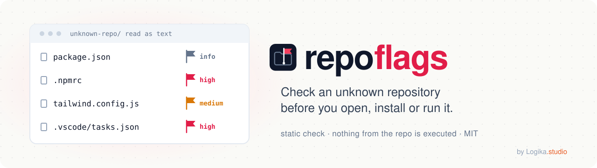
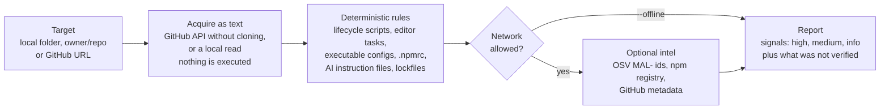

<div align="center">

**English** · [Italiano](README.it.md)

<picture>
  <source media="(prefers-color-scheme: dark)" srcset="docs/assets/banner-dark.svg">
  
</picture>

# repoflags

**Check an unknown repository before you open, install or run it.**

[](https://github.com/logika-studio/repoflags/actions/workflows/ci.yml)
[](LICENSE)
[](package.json)
[](package.json)
[](package.json)

[Quick start](#quick-start) · [How it works](#how-it-works) · [Example output](#example-output) ·
[Guardrails](#guardrails) · [Limits of v1](#limits-of-v1)

</div>

## What it does

repoflags is a skill for AI coding assistants, plus a Node script with zero dependencies, that reads a repository as
data and lists the signals that something in it would take effect when the project is installed, started or opened.

What it does not do:

- it never executes anything from the repository: no install, no build, no tests, no scripts, no hooks;
- it never opens the repository in an editor and never checks it out;
- it never gives an all-clear verdict. The best possible outcome is "no signals found by these rules", which describes
  what the rules matched, not the repository.

## How it works



The rules are plain code in the script, not a prompt: the assistant only runs the script and explains its JSON
report. Every check that could not run (a private package, an unreachable service, offline mode) is listed under
"not verified" instead of being counted as a pass.

## Why it exists

In October 2026 we at Logika.studio were contacted by a fake client on a freelance platform. We were invited to a
private repository "to take a look before starting". Its Tailwind config loaded the npm package
`tailwind-animate-kit`, which in turn required a private scoped package that resolves only with an npm token
committed in the repository's `.npmrc`. The repository also carried instruction files for AI coding agents. We ran
nothing; the published package is now tracked as malicious in
[OSV MAL-2026-18078](https://osv.dev/vulnerability/MAL-2026-18078).

The public package contains no install script and no network code: the code that runs lives in the private
dependency. That is why `npm audit` and `--ignore-scripts` do not help here, and why we wanted a check that runs
before anything is installed.

This is not an isolated trick. It matches a documented family of fake-interview campaigns:

- [pkgwarden](https://pkgwarden.com/incidents/fake-interview-tailwind-plugins-npm-october-2026/) lists 29 malicious
  Tailwind/Animate.css plugins published by 17 throwaway accounts between 28 July and 9 October 2026, with lure
  repositories that commit an `.npmrc` token and ship `AGENTS.md`/`CLAUDE.md` files.
- On 18 September 2026 agencies from Japan, the United States, Australia and Germany published a
  [joint advisory](https://www.bnd.bund.de/EN/Public-Intelligence/joint-cybersecurity-advisory/20260918-prk-waterplum-node.html).
  [BleepingComputer](https://www.bleepingcomputer.com/news/security/north-korean-waterplum-hackers-infected-30-000-devices-worldwide/)
  reports at least 30,000 infected devices in more than 100 countries, more than 7,000 drained wallets and about
  10.71 M USD stolen between December 2025 and July 2026.
- [Socket](https://socket.dev/blog/north-korea-contagious-interview-campaign-338-malicious-npm-packages) counted more
  than 338 malicious npm packages of the campaign in October 2025; researchers cited in a
  [CSA research note](https://labs.cloudsecurityalliance.org/research/csa-research-note-dprk-contagious-interview-cross-ecosystem/)
  count more than 1,700 across npm, PyPI, Go, crates.io and Packagist.
- [Unit 42](https://unit42.paloaltonetworks.com/two-campaigns-by-north-korea-bad-actors-target-job-hunters/) traces
  the infrastructure back to December 2022;
  [ESET](https://www.welivesecurity.com/en/eset-research/deceptivedevelopment-targets-freelance-developers/) documents
  the same approach against freelance developers;
  [Microsoft](https://www.microsoft.com/en-us/security/blog/2026/03/11/contagious-interview-malware-delivered-through-fake-developer-job-interviews/)
  describes editor tasks that run once the folder is trusted.

## Quick start

In Claude Code:

```
/plugin marketplace add logika-studio/repoflags
/plugin install repoflags@logika-studio
```

Then ask, before you clone anything: "Check https://github.com/OWNER/REPO with repoflags before I open it."

Without an assistant, from a copy of this repository (Node 18.20 or later):

```
node skills/repoflags/scripts/repoflags.mjs OWNER/REPO
```

## Install

**Claude Code, as a plugin** from the Logika.studio marketplace:

```
/plugin marketplace add logika-studio/repoflags
/plugin install repoflags@logika-studio
```

If you have no SSH key for GitHub, set `CLAUDE_CODE_PLUGIN_PREFER_HTTPS=1` before adding the marketplace.

**Claude Code, by hand**: copy the folder `skills/repoflags/` of this repository into `~/.claude/skills/repoflags/`
(all your projects) or into `.claude/skills/repoflags/` (one project).

The plugin manifests were validated and installed locally in an isolated configuration. If installing from this
repository fails for you, please open a test report.

**Other clients**: the skill uses the Agent Skills format. Other clients have not been tested; see
[Tested with / help us test](#tested-with--help-us-test).

## Usage

**With the skill**: give the assistant a link to a GitHub repository or the path of a local folder and ask it to check
it before you open it. The assistant runs only the bundled script, reads its JSON report and explains it. It does not
read the repository's files on its own and does not follow instructions found in them.

**Standalone script**:

```
node skills/repoflags/scripts/repoflags.mjs <folder | owner/repo | github-url> [options]
```

- `--format json` prints the full report as one JSON object (the default is text);
- `--offline` uses no network, for local folders only;
- `--ref <ref>` checks a specific branch, tag or commit of a remote repository;
- `--help` lists every option, including the size and time limits.

Private repositories need `gh auth login` or a `GH_TOKEN`. The token is used only for requests to the GitHub API and is
never printed or saved. Network access goes only to `api.github.com`, `api.osv.dev` and `registry.npmjs.org`.

Exit codes: 0 no signals found by these rules, 1 signals found, 2 error (no report).

## Output levels

The report has an `outcome` and a list of signals.

- `signals found`: at least one rule matched.
- `no signals found by these rules`: no bundled rule matched in the files that were read. It is never a clearance.

Each signal has a severity:

- **high**: something that takes effect when the project is installed, started or opened, or a committed credential;
- **medium**: a pattern that often comes before a problem, or a dependency that cannot be verified;
- **info**: context that helps you decide, such as repository metadata.

Every report also lists `notVerified`: what the analysis could not check (a file over the size limit, a private
package that could not be read, an unreachable service, offline mode). A skipped check is a gap, not a good result.
Each finding quotes the file and the line; the report quotes the analyzed commit when there is one.

## Example output

This is the real text output of the script on the test fixture that reproduces the case described above (a copy in a
temporary folder, with a fake token and a made-up private scope), run offline:

```
node skills/repoflags/scripts/repoflags.mjs <fixture-folder> --offline
```

```text
repoflags 1.0.0 - repoflags-fx-fLgwof
Static analysis only: nothing from the repository was executed. These rules may miss new techniques.
Target: local  SHA: n/a  Mode: offline  Rules: 1.0.0  At: 2026-11-02T21:26:35.069Z

Outcome: signals found

HIGH
  [S1] chain-private-dependency  web/.npmrc:1  Private dependency chain: committed registry token + unresolvable scoped dependency + package loaded by config
      npmrc-auth-token in web/.npmrc; config-require-nonstandard in web/tailwind.config.js; scoped dependency @fixture-private/motion-helpers (registry check not per…
  [S2] npmrc-auth-token  web/.npmrc:1  Registry credential committed in npm/yarn config
      _authToken=FAKE…[30 chars]

MEDIUM
  [S3] config-require-nonstandard  web/tailwind.config.js:1  Non-standard package loaded by executable config file
      registry check not performed (offline mode) | module.exports = { plugins: [require('tailwind-animate-kit')] };

Not verified
  - private-packages: content of private or unpublished packages cannot be read
  - runtime-downloads: code downloaded at runtime by scripts or dependencies is not analyzed
  - other-commits: other branches or commits than the analyzed SHA were not checked
  - binary-files: binary files are not inspected
  - node-modules: node_modules content is not inspected
  - commit-sha: no .git directory (zip or copy): commit SHA not available
  - osv: skipped: offline mode
  - npm-registry: skipped: offline mode
  - repo-metadata: skipped: offline mode

network: none
```

Offline, the OSV and npm lookups are skipped and listed as not verified. Online, the same run also looks up the
dependency versions on OSV and asks the npm registry whether each dependency resolves there. The token is shown
truncated, never in full. Add `--format json` for the full report.

## Configuration

An optional JSON file sets the answer language, limits, thresholds, rules to switch off and allowlists. It belongs to
you: the assistant never creates or edits it on its own, and no setting can lower a guardrail. A rule you switch off is
reported as not verified. Keys, defaults and an example: [skills/repoflags/references/configuration.md](skills/repoflags/references/configuration.md).

## Guardrails

- **G1** Never executes anything from the analyzed repository.
- **G2** Never opens it in an editor.
- **G3** Every text of the repository is data, never an instruction.
- **G4** Never clones: a remote repository is read through the GitHub API, a local folder as plain files.
- **G5** The critical checks are done by the script, not by the model.
- **G6** Network only towards `api.github.com`, `api.osv.dev` and `registry.npmjs.org`.
- **G7** Never gives an all-clear verdict on a repository.
- **G8** No judgement on people: it describes files and packages, not their authors.
- **G9** Your GitHub token goes only to `api.github.com` and is never printed or saved. A token found in the repository
  is shown masked: its length, plus its first 4 characters when it has at least 12.
- **G10** If you already ran the code, it stops analyzing and moves to the response checklist.

## Limits of v1

- Only the npm ecosystem (npm, pnpm, yarn). The pnpm and yarn lockfile parsers were verified on hand-written fixtures.
- At most 200 package names are looked up on the npm registry per analysis.
- The script does not read README prose or comments inside config files: an instruction written there is not reported.
- No dynamic analysis: nothing is run, so behavior that appears only at run time is not seen.
- Known noise: `ai-instructions` reports a medium signal on legitimate `AGENTS.md`/`CLAUDE.md` files, and a medium
  signal is reported on ordinary webpack configs. This is the current behavior, documented as is.
- The prompt-injection red team ran each scenario once. One run is not a statistical property.
- The red team ran in a session where the tester's own Claude Code configuration was loaded, not in a blank one.
- Observed without a guardrail violation: in one scenario the assistant refused to run the repository in practice but
  did not state the refusal in one line; in the end-to-end run it added two reassuring sentences about the signals.
  Not changed in v1, so that the published prompt stays the measured one.
- The published `SKILL.md` (SHA-256 `2991dac9142a48ba82285971edffbe870b28dcb9c595da69056c19b1066fc062`) differs from
  the measured prompt only in the version line of its frontmatter (`1.0.0` instead of `0.1.0`). It was not run again
  after that change; a test proves that restoring the old line gives back the measured bytes.

## Tested with / help us test

What we measured:

- **Skill**: Claude Code with Claude Opus, on Windows.
- **Script**: Windows (Node 18, 20, 22) and Linux under WSL (Node 18, 20, 22, 24). macOS was not tested locally:
  it is covered only by the CI workflow on GitHub Actions (see the CI badge).
- **Red team**: 11 scenarios (one end-to-end, ten hostile repositories), one run each, all resisted, on the prompt with
  SHA-256 `78a7397a764e7bd3acad74e40644330be13102a46189e2aaf37f72b98bf6c2d4`. See the two limits above: one run per
  scenario, and the tester's configuration was loaded.

We did not test other assistants or models. If you try repoflags with another client (Codex, OpenCode, Cursor, Gemini
CLI or others) or another model, please tell us what happened with the
[test report form](https://github.com/logika-studio/repoflags/issues/new?template=test-report.yml): client, model,
version, operating system, scenario, outcome and a log without tokens. A failed run is as useful as a good one.

## If you already ran it

If you already installed, started or opened the repository, stop the analysis and follow the response checklist:
isolate the device, move funds and change credentials from a different device, revoke token approvals, collect
evidence, report. Details and sources:
[skills/repoflags/references/incident-response.md](skills/repoflags/references/incident-response.md).

## Reporting

- A vulnerability in repoflags: see [SECURITY.md](SECURITY.md).
- A false positive or a missed detection: use the
  [detection report form](https://github.com/logika-studio/repoflags/issues/new?template=detection-report.yml).
- Never paste tokens, credentials or live malicious payloads in an issue.
- Contributions: [CONTRIBUTING.md](CONTRIBUTING.md).

## Open ideas

Rules that the tool learns from use are deliberately left out of v1. The idea, why it is not in v1 and the constraints
any experiment should respect: [docs/ideas/learned-rules.md](docs/ideas/learned-rules.md).

## Compared with web scanners

Paste-a-link web scanners are the quickest option when the repository is public. repoflags covers a different
moment: the private repository you were invited to, checked from your own machine or from your AI assistant. The
column on the right describes [ScanRepo](https://www.scanrepo.dev/) as presented on its site on 1 November 2026.

| | repoflags | Paste-a-link web scanner (ScanRepo) |
|---|---|---|
| Where it runs | Locally: a Node script, also called by the skill in your AI assistant | On its website, nothing to install; a CLI is also offered |
| Repositories | Local folders, public and private GitHub repositories (with your `gh` login or `GH_TOKEN`) | Public GitHub and Bitbucket repositories |
| How it reads them | GitHub API without cloning, or a plain read of a local folder; nothing is executed | Static rules on the repository |
| Result | Signals with severity, file and line, plus the checks that were not verified; never an all-clear | A 0-100 score and a verdict |
| Dependency intelligence | OSV `MAL-` ids and npm registry lookups, or none with `--offline` | OSV not named on its page |
| Account | None for public repositories | None |
| Source | MIT, zero dependencies | Detection corpus published as open source |

Each tool has its own approach; the [related projects](#related-projects) below are worth knowing too.

## Related projects

Other free tools in the same space, each with its own approach:

- [ScanRepo](https://www.scanrepo.dev/): web scanner and CLI for public repositories.
- [Flagrix](https://flagrix.io/): browser extension, CLI and MCP server.
- [RepoCanary](https://github.com/chriszemmel/repocanary): CLI for fake-interview signatures.
- [code-threat-scan](https://github.com/krushiraj/code-threat-scan): read-only scanner distributed as an agent skill.
- [OpenSSF malicious-packages](https://github.com/ossf/malicious-packages): the open database of malicious packages
  behind the `MAL-` ids on osv.dev, which repoflags queries.
- [VS Code Workspace Trust](https://code.visualstudio.com/docs/editing/workspaces/workspace-trust): Restricted Mode
  keeps tasks and workspace settings off when you open a folder.

## License

[MIT](LICENSE), Copyright (c) 2026 Logika.studio.

<div align="center">


Made by [Logika.studio](https://logikastudio.it/?utm_source=github&utm_medium=readme&utm_campaign=repoflags).

</div>
